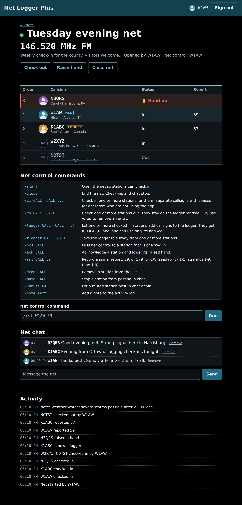
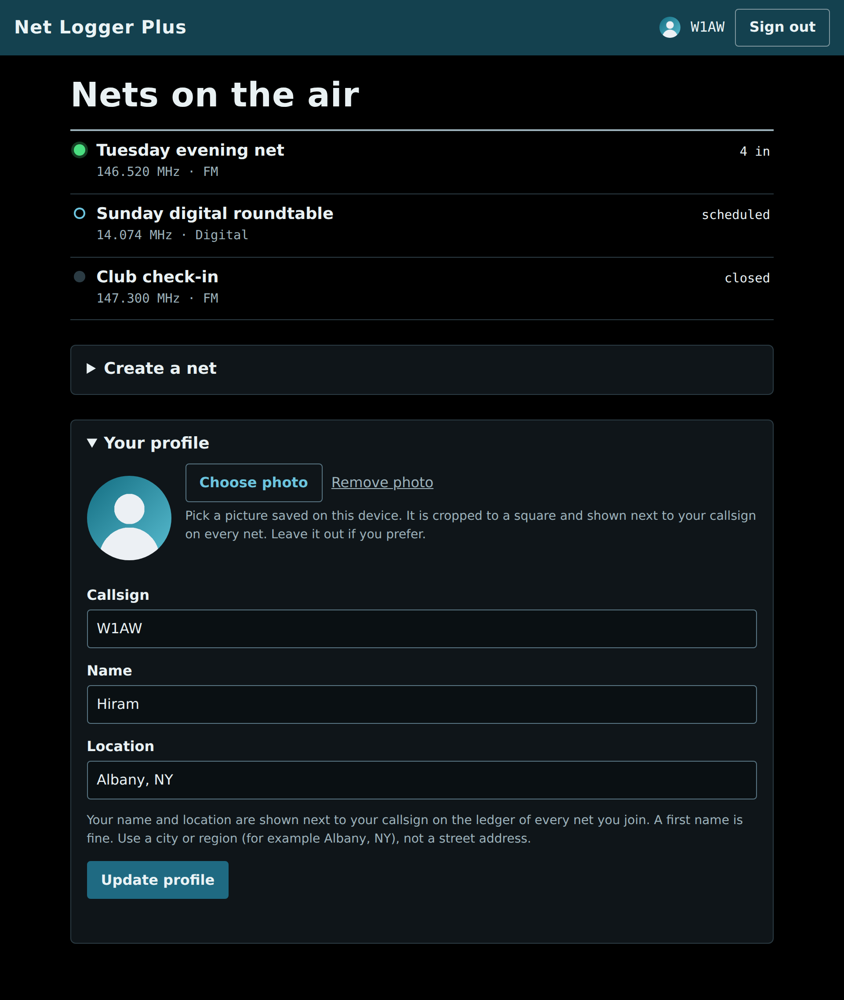
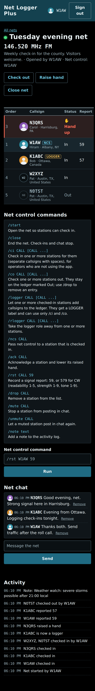

# Net Logger Plus

A small, self-hostable web app for running amateur radio nets. Modeled on the open-source
[Ham.Live](https://github.com/Constant-Digital-Holdings-LLC/hamlive-oss) architecture
(Node server, real-time updates over Server-Sent Events, passwordless sign-in, net control
commands, chat, QRZ lookup), rebuilt with **no required dependencies** and with the gaps found
in that project's review closed.

Requires Node 20.19 or newer (tested on 20, 22 and 24; 24, the current long-term-support release, is recommended).
No `npm install` step, unless you choose MongoDB.

## Run it

    npm run dev       # http://localhost:3000, sign-in link shown on screen
    npm test          # unit and API tests (node:test, no setup)
    npm run test:e2e  # browser tests (see below)

1. Enter your email and click the dev sign-in link.
2. Set your callsign, name and location.
3. Create a net, open it, and press **Start net**.
4. Open the net in a second browser (another email and callsign) to check in and raise a hand.

Net control commands (box under the ledger):
`/start /close /ci CALL [CALL ...] /co CALL [CALL ...] /logger CALL [CALL ...] /rlogger CALL [CALL ...] /ncs CALL /ack CALL /rst CALL 59 /drop CALL /mute CALL /unmute CALL /note text`

The page lists every command, with a description, above the box. `/ci` is for operators who are on the air
but not using the app: net control checks them in, and if that operator signs in later they simply take over
their own entry (no duplicate). Give it one callsign or several separated by spaces (`/ci W2XYZ K1ABC N3QRS`,
up to 25): they join the ledger in the order typed, each gets its QRZ name and location, the log shows one line,
and anything it had to skip (not a callsign, already checked in) is listed in a notice rather than failing the rest.

`/co CALL [CALL ...]` is the other half: it checks one or several stations out, exactly as the Check out button
does for a person. The entries stay on the ledger marked Out (struck through) so the order is not lost, any raised
hand is lowered, and a logger's role ends. `/ci` brings the same entry straight back in, with no duplicate; to remove
an entry entirely use `/drop`. As with `/ci`, anything it had to skip (not on the list, already checked out, not a
callsign) is listed in a notice. Net control can use `/co` on anyone; loggers can use it too, but not on net control or another logger.

## Tests

**`npm test`** (168 tests, no dependencies): pure logic, auth, QRZ client against sample XML, the MongoDB
store and import against a fake driver, config guards (including domain and IP `BASE_URL`s), the Debian installer in every address mode, and the HTTP API including live chat streams.

**`npm run test:e2e`** drives the real UI in Chromium (33 tests, about 2 minutes). One-time setup:

    npm install
    npm run test:e2e:install       # downloads Chromium

It boots Net Logger Plus on port 3200 with a throw-away data directory, plus a fake QRZ server on 3201 (the app
reads `QRZ_BASE_URL`, which is also how you would point it at a QRZ-compatible mirror), then covers:
magic-link sign-in (and that a link works once), callsign validation, create/start/close a net,
live check-in and hand-raise between two browsers without reloads, net control commands, chat delivery,
history, removal and mute, QRZ details in the ledger, choosing and removing a profile picture, anonymous viewers seeing no chat,
text from users never being rendered as HTML, the CSP and security headers, and a 375 px phone layout with
no sideways scroll. Any Content-Security-Policy violation or uncaught page error fails the test it happens in.
On failure, screenshots and traces land in `test-results/` (`npx playwright show-trace <file>`).
Set `CI=1` for one retry and an HTML report.

## Screenshots

    npm install
    npm run test:e2e:install     # one-time: downloads Chromium
    npm run screenshots          # writes PNGs to docs/screenshots/

The script starts its own throw-away server and fake QRZ service (ports 3300 and 3301), fills them with demo
nets and operators, and saves: `home`, `home-signed-out`, `net-control`, `net-logger`, `net-visitor` (desktop) and
`net-phone` (390 px phone layout) and `profile` (the profile-picture controls). It never touches your real data. `npm run screenshots -- --check` seeds
the demo data and verifies it without opening a browser. The script also seeds demo profile pictures (a few operators have one, the stations net control checked in do not, so
both looks are shown), and `--chrome PATH` (or `CHROME_PATH`) runs it with a Chromium you already have.

## Loggers

Net control can let other stations help build the ledger. `/logger CALL [CALL ...]` makes one or several
checked-in stations **loggers**: each gets an amber `LOGGER` label beside their callsign on the ledger, and a
"Logger commands" box on their own screen that accepts `/ci` and `/co` and nothing else, so they can add
callsigns (each looked up on QRZ as usual) and check stations out again, for example to fix a callsign added by
mistake, but cannot close the net, mute people, name more loggers, or anything else. The activity log records who
did what, for example `KC2ABC, W6NCO checked in by W2XYZ (logger)` and `W6NCO checked out by W2XYZ (logger)`.

- **What a logger cannot check out:** net control (including the net owner) or another logger. Checking a station
  out also ends its logger role, so letting loggers do that to each other would let them strip roles; only net
  control can. A logger can check themselves out, which ends their own role.

- **Who can be a logger:** a station that is checked in and has signed in to Net Logger Plus (they need an account to type
  commands). Net control and the net owner already have full control; stations net control checked in with
  `/ci` and who have not signed in yet are skipped, with the reason shown.
- **Taking it away:** `/rlogger CALL [CALL ...]`. The role also ends when a logger checks out, or when
  `/ncs` makes them net control. Net control can name them again at any time.
- **The server enforces it,** not just the page: every logger action is checked on the server, and each person is
  sent only the commands they may use. The role belongs to the account, not only the callsign.
- Roles update live: a logger's command box appears, or disappears, without reloading.

## Registration: callsign, name and location

After the emailed sign-in link, every new account must give a **callsign**, a **name** and a **location** (for example
`Hiram` and `Albany, NY`) before it can create or join a net, check in, or chat. They are saved to the account's
profile, and all three appear on the ledger: the callsign, with the name and location on the line under it. Watching
nets needs no account.

- **No QRZ needed.** The name and location are whatever the operator types, so this works with no QRZ account at all.
  If QRZ is set up it fills in a name or location only for stations net control checked in with `/ci`, who have no
  profile; for everyone else the name they typed is what the ledger shows.
- **Privacy.** The name and location are shown to everyone who views the net, so the form says a first name is fine and
  asks for a city or region, not a street address. The name is limited to 40 characters and the location to 60. Neither
  is verified.
- **Fixing mistakes.** "Your profile" on the home page edits the callsign, name and location. Nets still running update
  immediately; closed nets keep what was shown at the time.
- **Existing accounts** from before the name was added are asked for it the next time they open the home page. Until
  then they can watch, but not create, join or chat (the server enforces this, not just the page).

## Profile picture

Signed-in operators can add a picture in **Your profile** on the home page. **Choose photo** opens the device's saved
photos (the photo library or camera roll on a phone, the file picker on a computer). The browser centre-crops it to a
256 px square and re-encodes it as a JPEG before sending, so uploads are tiny and any location data inside the photo is
dropped. **Remove photo** goes back to the callsign's first letters. The picture shows beside the callsign in the page
header, on the ledger of every net the operator is on (live, for everyone including visitors) and next to their chat
messages. Watching nets still needs no account.

- **Safe by construction.** The server looks at the file's first bytes, not at what the browser says it is: only real
  JPEG, PNG and WebP are accepted (never SVG, which can carry scripts), at most 512 KB, and 10 changes per 15 minutes per
  account. Files are served with `nosniff`.
- **Unguessable addresses.** Each upload is stored under a fresh random 128-bit id (`/avatars/<id>`), never the email or
  callsign. A new picture is a new address, so old ones are deleted and browsers can cache them for a year. Pictures are
  public to anyone who has the address, like the ledger itself; the page never links an email to one.
- **History.** Nets still running pick up a new or removed picture at once; a closed net keeps showing what it showed (if
  that file has since been replaced, the letters appear instead).
- **Where they live.** In an `avatars` folder beside the data file (`/var/lib/net-logger-plus/avatars` on the Debian
  install), or `AVATAR_DIR`. They stay on disk even if you use MongoDB, so **back that folder up with `db.json`**.
- **Google photo (not built yet).** The profile record already has a place for a picture, so pulling the photo from a
  Google account can be added with Google sign-in later without changing anything here.

## Chat

Every net page has a live chat for signed-in operators (readable and writable only with a
session and a callsign). Messages are plain text, 500 characters, last 200 kept per net,
20 per minute per user. Net control can remove any message (button next to it) and
`/mute CALL` blocks a station from posting until `/unmute CALL`. Chat becomes read-only when
the net closes. Logging out closes that session's live stream immediately.
Inline images are deliberately not supported (the CSP only allows images from this site).

## QRZ lookups (optional)

An optional extra: set `QRZ_USERNAME` and `QRZ_PASSWORD` (a QRZ XML data subscription) and restart. Net Logger Plus then
looks a callsign up on QRZ **only when it is added to the ledger** (the Check in button, `/ci`, and so on). There
is no separate lookup box: a net page shows the ledger, the commands (for net control and loggers), live chat and
the activity log, nothing else.

- **What it adds:** the operator's first name, and a location for stations that did not type one themselves
  (for example those net control checked in with `/ci`). That is all that is kept; no street address, email,
  phone, grid square or licence details.
- **`QRZ_REQUIRE=1`** rejects callsigns QRZ has no record of when a user sets their callsign.
  This checks that the callsign exists, not that the person holds it.
- Results are cached 24 h (10 min for misses), concurrent lookups share one request and at most three run at
  once, and a failed login backs off for 5 min.
- QRZ down or not configured? Everything else keeps working; ledger entries simply have no QRZ details.
- **Names need a QRZ XML data subscription; locations do not** (people type their own at registration). QRZ lets
  any account log in, but without a subscription it returns fewer fields (intended for testing). Net Logger Plus shows
  whatever QRZ returns: full details, partial details (for example just a country), or nothing. A record with no
  name and no location draws nothing, and check-in never depends on QRZ. Where both exist, the ledger shows QRZ's
  name with the location the operator typed.
- Failed lookups are remembered so they are not retried and logged on every request: 10 minutes for an error QRZ
  itself reports (such as "subscription required"), 1 minute for network trouble. Watch for them with
  `sudo journalctl -u net-logger-plus | grep QRZ`.
- Do not set `QRZ_REQUIRE=1` with a free QRZ account: if QRZ returns nothing usable for a callsign, people would be
  refused when they set it.
- Review QRZ's terms of use for how you display their data on a public instance.

## MongoDB

    npm install mongodb
    MONGODB_URI=mongodb://localhost:27017 MONGODB_DB=net-logger-plus npm start

Same app, same behaviour; data goes to MongoDB instead of `data/db.json`.
Collections: `users`, `sessions`, `tokens`, `nets`, `chat`. Sessions and sign-in tokens get a TTL
index so MongoDB expires them by itself. Nets older than 30 days (closed, or never started)
are pruned along with their chat.

How it works: the working set is held in memory and changed documents are diffed and written with
one `bulkWrite` per collection (debounced 250 ms; a failed write is retried on the next change;
shutdown flushes). That keeps the code simple and fast, but it is a **single-instance** design:
run one Net Logger Plus process per database (live updates and rate limits are in-process too).

### Moving an existing `data/db.json` into MongoDB

    npm install mongodb
    node scripts/import-json-to-mongo.js --dry-run     # validate the file; touches no database
    node scripts/import-json-to-mongo.js               # import (target database must be empty)

The script reads `MONGODB_URI`, `MONGODB_DB` and `DATA_FILE` (or `.env`), or take `--uri`, `--db`, `--file`.

| Flag | Effect |
|---|---|
| *(none)* | Refuses if the target already holds Net Logger Plus data, so you cannot clobber a database by accident |
| `--merge` | Adds records whose id is missing; never overwrites an existing record |
| `--replace --yes` | Deletes the five Net Logger Plus collections first, then imports |
| `--no-sessions` | Do not carry over logged-in sessions (everyone signs in again) |
| `--dry-run` | Validate and report only |

It checks the file's structure first (ids match their keys, nets have `stations`/`log`, chat is arrays,
sessions have expiries) and imports nothing if anything is wrong. Expired sessions and sign-in
tokens are left out. Keep the same `SESSION_SECRET` if you want carried-over sessions to stay valid.
Stop Net Logger Plus while importing, and keep `db.json` as your backup. Run it once; it is not a sync tool.

## Deploy on Debian 13 (systemd + Caddy), with a domain or just an IP address

Files in `deploy/`: `net-logger-plus.service` (sandboxed systemd unit), `Caddyfile` (reverse-proxy template),
`net-logger-plus.env.example` (settings template), and `install-debian.sh` (does all of it).

    sudo apt update && sudo apt install -y git
    git clone https://github.com/k9rzl/net-logger-plus.git
    cd net-logger-plus

    # Option A: you have a domain name (trusted HTTPS, automatic)
    sudo bash deploy/install-debian.sh --domain nets.example.org --caddy

    # Option B: you only have an IP address
    sudo bash deploy/install-debian.sh --ip 203.0.113.10 --caddy      # or --ip auto, or an IPv6 address

| Mode | Browser sees | Needs | Good for |
|---|---|---|---|
| `--domain nets.example.org` | Trusted HTTPS (Let's Encrypt, auto-renewed) | DNS record pointing here; ports 80 and 443 open | Anything public |
| `--ip ADDR` (same as `--tls internal`) | HTTPS with a certificate your own Caddy signs: encrypted, but browsers show a warning until each device trusts the Caddy root certificate | Ports 80 and 443 open | Clubs and tests without a domain |
| `--ip ADDR --tls letsencrypt` | Trusted HTTPS via a short-lived (6-day, auto-renewed) Let's Encrypt IP certificate; falls back to the self-signed one if issuance fails | A public IP, port 80 reachable from the internet, and a recent Caddy (Debian's packaged Caddy may be too old; the installer checks and tells you) | Public use without a domain |
| `--ip ADDR --tls none` | Plain HTTP, **not encrypted** | Port 80 open | A trusted network, or a short test |

With plain HTTP, sign-in links and session cookies cross the network in the clear, so anyone on the path can
take over an account. Net Logger Plus prints a warning at startup in that mode. Use it deliberately.

**Trusting the self-signed certificate** (removes the browser warning): copy
`/var/lib/caddy/.local/share/caddy/pki/authorities/local/root.crt` from the server and install it as a trusted
root certificate on each device that will use Net Logger Plus. Without that step you can still click through the warning.

**Changing later.** Re-run the installer with the new `--domain` or `--ip` (and `--caddy`); it updates
`BASE_URL` and the Caddyfile and keeps your secret, data and other settings. Run it with no address flags to
simply upgrade the code (`git pull`, then `sudo bash deploy/install-debian.sh`). To run a specific release,
`git checkout v0.1.0` first. For a private repository, clone with a deploy key or read-only token.

The installer installs Node.js from Debian if needed (Debian 13 ships Node 20.19, which works but passed Node's
upstream end of life in April 2026, so the installer says so; for Node 24 install it from nodejs.org first and the
installer will use it. npm is not needed to run
Net Logger Plus), copies the app to `/opt/net-logger-plus`, writes `/etc/net-logger-plus/net-logger-plus.env` with a freshly generated
`SESSION_SECRET`, and starts the service. With `--caddy` it installs Caddy and, before replacing anything,
asks Caddy to validate the new configuration; an existing Caddyfile is backed up first. Skip `--caddy` if you
already run nginx or another proxy: proxy to `127.0.0.1:3000` and forward live-update streams unbuffered.

Where things live:

| What | Where |
|---|---|
| App code (read-only to the service) | `/opt/net-logger-plus` |
| Settings and secrets | `/etc/net-logger-plus/net-logger-plus.env` (mode 600) |
| Data | `/var/lib/net-logger-plus/db.json`, owned by a throw-away system user (back this up; writes are atomic) |
| Logs | `sudo journalctl -u net-logger-plus -f` |
| Restart after editing settings | `sudo systemctl restart net-logger-plus` |

**Sign-in emails.** Set `MAIL_WEBHOOK_URL` (any relay that accepts a JSON POST of `{to, subject, text}`).
Until you do, sign-in links are written to the log, which is enough for a one-person club:
`sudo journalctl -u net-logger-plus -f`.

**Network exposure.** Net Logger Plus listens on `127.0.0.1` by default (`HOST`), so only the proxy can reach it.
This matters: with `TRUST_PROXY=1` the app believes the proxy's `X-Forwarded-For` header for per-client rate
limits, which would be spoofable if the port were reachable directly. Set `HOST=0.0.0.0` only for containers
or a trusted LAN, and then do not set `TRUST_PROXY=1` unless a proxy is the only way in.

**Production safety checks.** With `NODE_ENV=production` the app refuses to start without a 32+ character
`SESSION_SECRET`, and refuses `DEV_LINKS=1` or an `http://` `QRZ_BASE_URL`. `BASE_URL` may be a domain or an IP
address (`https://[2001:db8::10]` for IPv6). HSTS is sent only for real domain names, because browsers ignore it
for IP addresses and it would make a self-signed certificate impossible to click through.

**Hardening.** The unit runs with no privileges, a read-only filesystem except its data directory, no home
access, and a restricted set of network address families (`systemd-analyze security` rated it "OK").
`MemoryDenyWriteExecute` is deliberately not set because Node's JavaScript engine needs it off.

Manual install instead: copy `deploy/net-logger-plus.service` to `/etc/systemd/system/`, the env template to
`/etc/net-logger-plus/net-logger-plus.env` (set `BASE_URL` and a 32+ character `SESSION_SECRET`), then
`sudo systemctl enable --now net-logger-plus`.

## What changed versus Ham.Live OSS

| Area | Ham.Live OSS | Net Logger Plus |
|---|---|---|
| Sign-in link | 30-day JWT; link shown on page when email is unset | Random 256-bit token, hashed, single use, 15 min; on-screen link only with `DEV_LINKS=1`, never in production |
| Link scanners | Link click signs in | Token travels in the URL fragment and needs a button press, so mail scanners cannot burn it |
| Sessions | Stateless cookie, one key, no revocation | Server-side sessions (revocable), HMAC-signed id, 7 days, HttpOnly + SameSite=Lax (+Secure on https) |
| Rate limiting | None found | Per-IP and per-email limits on sign-in; per-user limits on actions; SSE connection cap |
| CSRF | Not documented | Custom header plus same-origin check on every state-changing call |
| Headers | No helmet/CSP | Strict CSP (`default-src 'none'`, scripts/styles `'self'`), nosniff, no-referrer, frame denial, HSTS on https |
| Privacy | n/a | Public views never include email addresses |
| Dependencies | ~40 (Mongoose 6 EOL, etc.) | None required; `mongodb` driver only if you use MongoDB |
| Tests | None | `npm test` |
| Source layout | Compiled `dist/` committed, JS/TS mixed | Plain ESM source, nothing generated |

## Layout

    deploy/           systemd unit, Caddyfile, env template, Debian install script
    src/server.js     HTTP routing, security headers, static files, mail relay
    src/auth.js       sign-in tokens and sessions
    src/domain.js     nets, check-in, hands, net control commands (pure functions)
    src/sse.js        live updates
    src/chat.js       per-net chat
    src/avatars.js    profile picture files (type check by bytes, random ids)
    src/qrz.js        QRZ XML client (cache, session handling)
    src/store.js      JSON file persistence (atomic writes)
    src/mongostore.js MongoDB persistence
    src/migrate.js    validation and import logic behind the import script
    scripts/          import-json-to-mongo.js, screenshots.js
    docs/screenshots/ generated by npm run screenshots
    e2e/              Playwright browser tests and a fake QRZ server
    public/           vanilla ES modules, no build step

## Known limits

- Callsigns are not verified against a licence database. First account to claim a callsign owns it. Locations are
  self-reported and unverified.
- Single process only (JSON file or MongoDB): right for clubs, not for horizontal scaling.
- The MongoDB store and the import script were tested against a fake driver, not a live MongoDB server,
  and the QRZ client against sample XML and a fake server, not the live QRZ service. Try both on a test
  instance (and run the import with `--dry-run` first) before relying on them.
- Browser tests run in Chromium only.
- Live updates use one Server-Sent Events connection per open net, shared by every tab of the same browser through a
  SharedWorker, so any number of tabs costs one connection (two for a person who is signed in, because chat rides on
  theirs). Browsers without SharedWorker fall back to one connection per tab. Over plain HTTP/1.1 they allow only six
  connections per site, so with `--tls none` (or direct HTTP) keeping more than about five tabs open in such a browser
  can make buttons hang until a tab is closed. HTTPS through Caddy uses HTTP/2, which removes that limit.
- The systemd unit was checked with `systemd-analyze` and the install script was run into a scratch directory
  and the installed copy started in production mode, but none of it has run on a real Debian 13 machine,
  and the generated Caddyfiles have not been run through Caddy. In particular the Let's Encrypt IP-certificate
  mode (`--tls letsencrypt`) is untested against the real service.
- Chat has no image support and no per-user block list beyond net control's mute.
